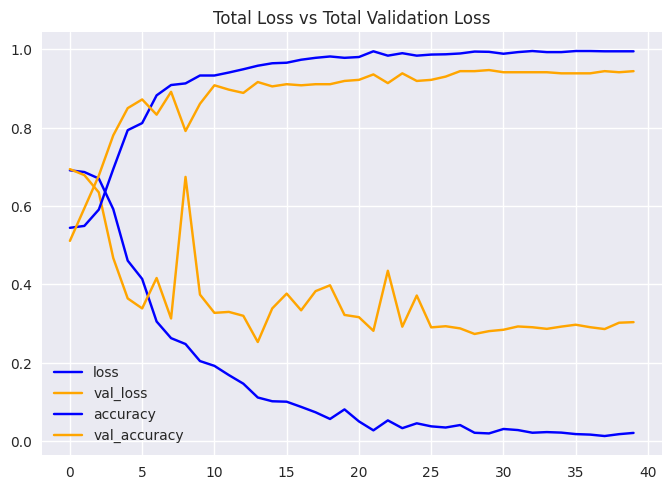

# Video Violence Guard


[](https://www.kaggle.com/code/markkostantine/video-violence-guard-transfer-learning)

A video classifier that decides whether a clip contains **violence** or **non-violence**. It combines a pretrained **MobileNetV2** (transfer learning) with a **bidirectional LSTM** over 16 sampled frames, and can classify a video straight from a URL.

**94% test accuracy** on 200 held-out videos.

## How it works
1. **Frame sampling:** 16 evenly spaced frames per video, resized to 64 x 64.
2. **Per-frame features:** MobileNetV2 (ImageNet weights, last 40 layers trainable) applied to every frame with `TimeDistributed`.
3. **Temporal model:** dropout, then a bidirectional LSTM (32 units) over the 16 frame features, then a small dense head with a 2-class softmax (3.6M parameters, 3.1M trainable).
4. **Inference:** `predict_video` classifies a file and returns the class and its confidence. `predict_video_from_url` does the same from a YouTube URL using `pytube`.

## Dataset
[Real Life Violence Situations Dataset](https://www.kaggle.com/search?q=Real+Life+Violence+Situations+Dataset) on Kaggle: 2,000 videos in two classes, `NonViolence` and `Violence`. Split 90 / 10 into 1,800 training and 200 test videos, with 20% of the training set used for validation. It is not included in this repo.

## Training
SGD, batch size 8, up to 50 epochs, early stopping on validation accuracy (patience 10, best weights restored) and `ReduceLROnPlateau`.

## Results (200 test videos)
| Class | Precision | Recall | F1 | Videos |
|---|---|---|---|---|
| NonViolence | 0.96 | 0.92 | 0.94 | 99 |
| Violence | 0.92 | 0.96 | 0.94 | 101 |
| **Accuracy** | | | **0.94** | 200 |

Confusion matrix (rows = true class, columns = predicted class):

| | Predicted NonViolence | Predicted Violence |
|---|---|---|
| **True NonViolence** | 91 | 8 |
| **True Violence** | 4 | 97 |



Training accuracy reaches about 99.5% against about 94% on validation, so the model overfits somewhat.

## Limitations and next steps
- 64 x 64 frames and 16 samples per clip lose detail. Try larger frames, more frames or a 3D-CNN / video transformer.
- The dataset is limited to its recording conditions, so check how well it generalises to other video sources.
- Add data augmentation and test on a separate dataset.
- `pytube` often breaks when YouTube changes. Swap in `yt-dlp` for URL input.

## Run it
```bash
git clone https://github.com/MarkKostantine/Video-Violence-Guard.git
cd Video-Violence-Guard
pip install -r requirements.txt
jupyter notebook video-violence-guard.ipynb
```
The notebook uses Kaggle paths (`../input/real-life-violence-situations-dataset/...`), so adjust them locally, or run the [original Kaggle notebook](https://www.kaggle.com/code/markkostantine/video-violence-guard-transfer-learning). Plotting the model structure needs Graphviz.
